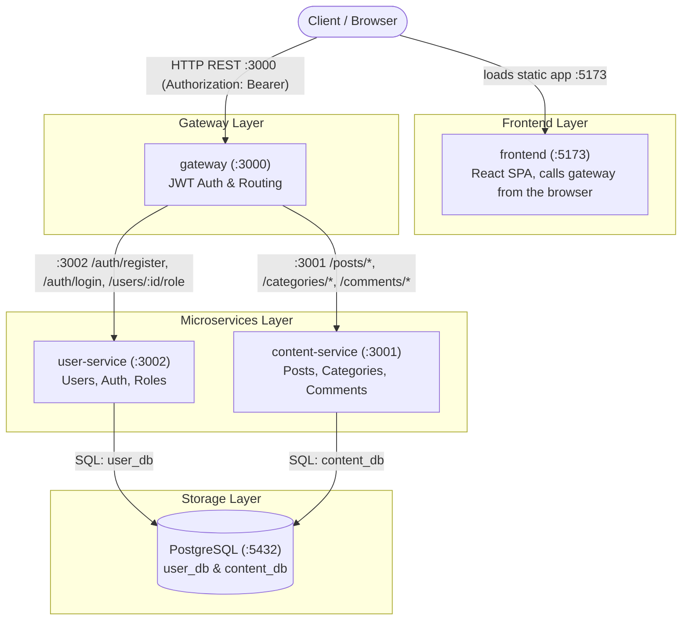
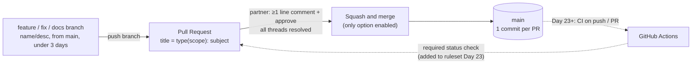

# System Architecture — Blog / CMS Platform

Note: `frontend` only serves the static React bundle to the browser — the actual API traffic (`Client -->|HTTP REST :3000| GW`) is issued by JavaScript running *inside the browser*, not by the `frontend` container itself. This is why both arrows originate from `Client`, not from `FE`.

## Change delivery flow

How a change reaches `main` in any of the 5 repos (`gateway`, `user-service`, `content-service`, `frontend`, `docs`). Rules and naming: see `CONTRIBUTING.md`.

| Gate | Enforced by | Status |
|---|---|---|
| No direct push / force push / deletion of `main` | Repository Ruleset `Protect main` (active, bypass list empty) | on — direct push rejected with `GH013` |
| 1 approval, stale approval dismissed on new push, threads resolved | same ruleset, `pull_request` rule | on |
| Squash only, PR title becomes the commit | repo settings → Pull Requests | on |
| CI green before merge | ruleset `required_status_checks` | **off until Day 23** — needs an existing workflow check name |

Why repository-level rulesets: legacy Branch Protection and Org Rulesets need GitHub Team for private repos; repository rulesets work on the free plan, so the same setup is repeated in each repo.
